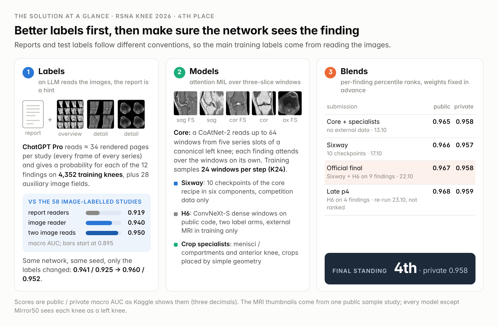
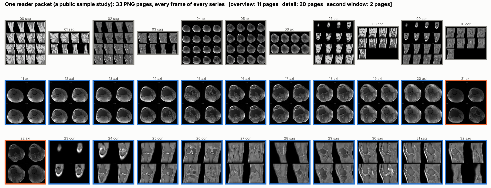
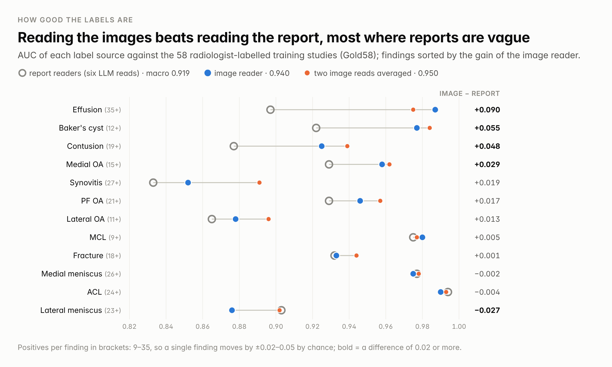
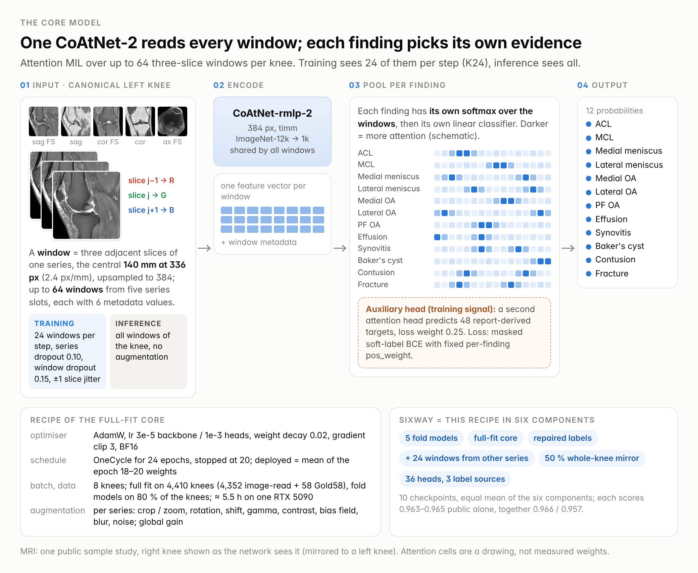
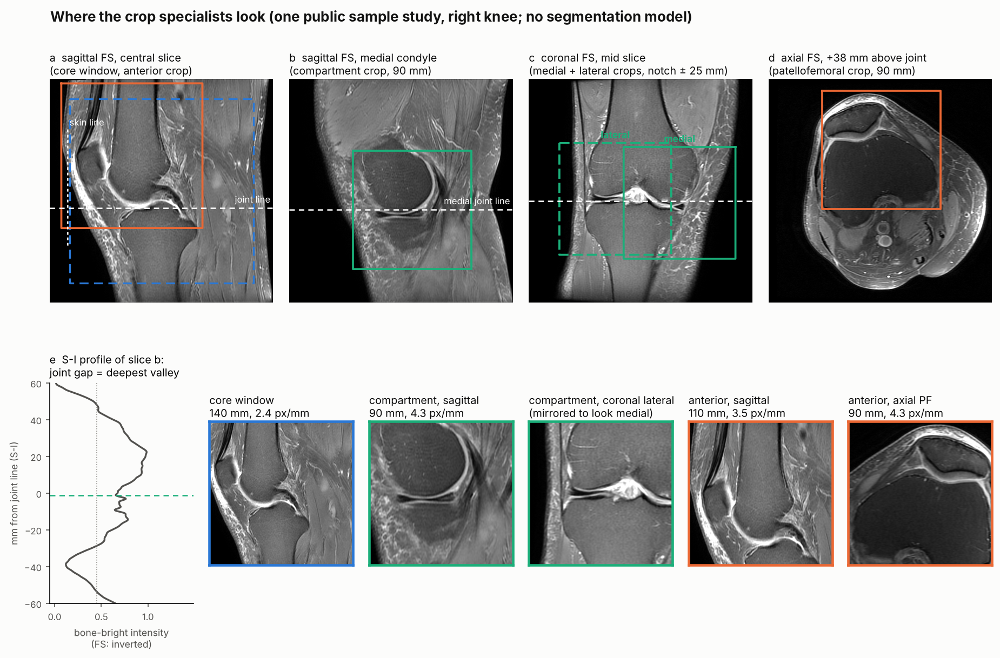
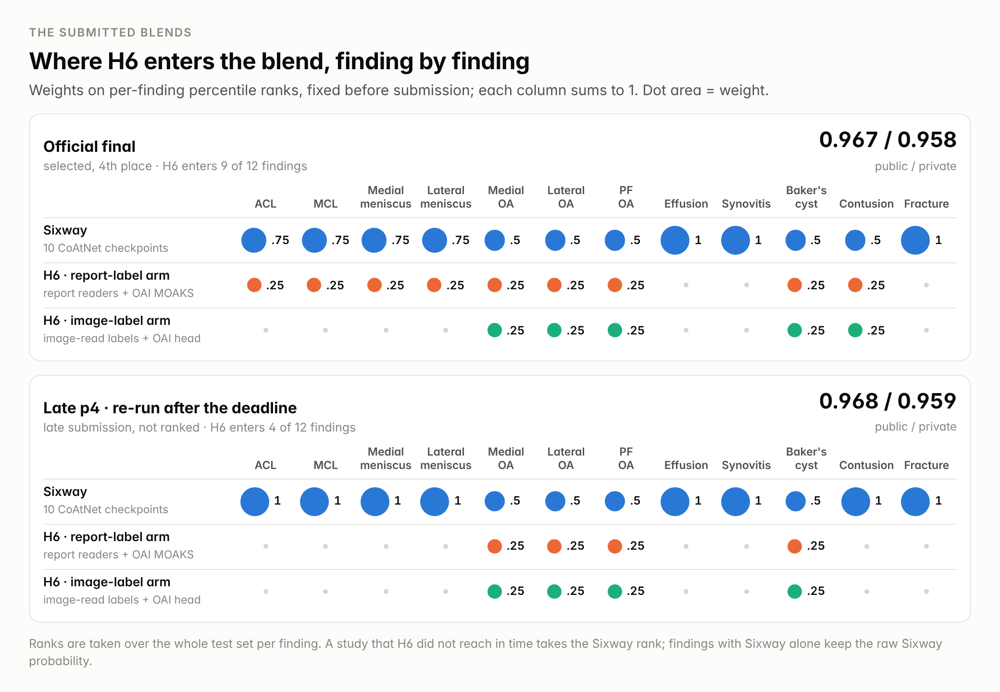
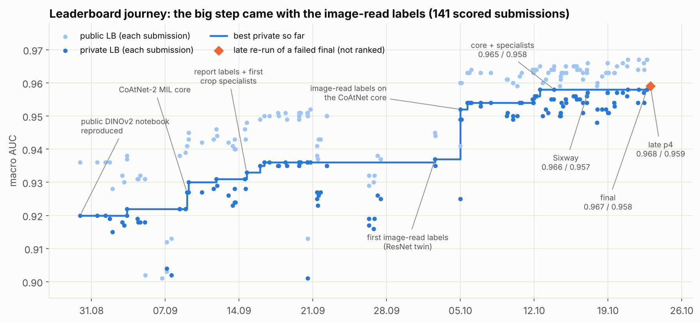

# 4th place: an LLM reads the images, a MIL network learns where to look

Thanks to RSNA, the annotating radiologists and Kaggle for the competition and for the careful label definitions.

Private 0.958 (4th place), public 0.967. Our best blend failed to score on deadline day; its re-run after the deadline scored 0.968 / 0.959 (not ranked, section 4).

## Overview

Only 58 of the 4,407 training studies have labels read from the images (we call them Gold58). The rest come with a free-text report, and the test set (about 1,300 studies) is labelled by radiologists from the images. The two conventions differ: on the same training studies our report readers call medial / lateral / PF OA positive in 26 / 15 / 29 % of the knees, our image reader in 16 / 6 / 16 %. So most of our work went into the labels.

- **Labels.** ChatGPT Pro looked at rendered MRI pages of every training study, with the report as an untrusted hint, and gave a probability for each of the 12 findings. Same network, same data, same seed, only the labels changed: 0.941 / 0.925 → 0.960 / 0.952 (public / private).
- **Model.** A CoAtNet-2 attention-MIL network over up to 64 three-slice windows per knee, trained on 24 sampled windows per step, plus two crop specialists (menisci and compartments, anterior knee) whose crops are placed by simple geometry. Competition data only: 0.965 / 0.958.
- **Ensemble.** Six variants of the core (10 checkpoints), rank-blended per finding with a ConvNeXt-S trained on public code with external knee MRI: 0.967 / 0.958, our final.

*Figure 1. Labels, models and blends. Scores are public / private as Kaggle shows them.*

## 1. Labels: an LLM reads the images

### What the reader sees

For every training study we rendered a packet of PNG pages (median 34, at most 42):

- overview pages with every frame of every series, 4×4 tiles, each captioned with its frame index and position;
- detail pages with one fluid-sensitive series per plane at native resolution;
- a second, wider window on the axial fat-suppressed series, for bright fluid and marrow oedema.

Tiles are scaled by pixel spacing, so proportions are true. Above about 42 pages the model started to drop images from its context, hence the budget.

*Figure 2. The 33 pages of one public sample study: overview pages (grey), detail pages (blue), second window (orange).*

### How it reads

The protocol mattered more than the prompt wording:

1. Read the organisers' definitions verbatim, a checklist of structures to inspect for each finding, and rules for using the report.
2. Read the report first, as an untrusted hint. A claimed finding is a reason to look; a negation does not cancel what is visible; silence is not "no"; words like "mild" or "small" do not set the grade.
3. View every page in order. If images drop out of the context before the decisions, view the study again.
4. For each finding, give a criterion status (met / not met / unassessable), then the probability that the full definition is met. 28 auxiliary image fields (cartilage grade per compartment, marrow oedema by zone, effusion size, ...) are filled after the 12 decisions and do not change them.
5. Answer with one compact JSON record per study.

The training label is that probability. We read 4,356 knees (seven bilateral studies were read per knee) in about 150 ChatGPT Pro chats of about 30 studies each, from 26.09 to 02.10; the host allowed commercial LLMs for processing competition data ([thread 733965](https://www.kaggle.com/competitions/rsna-knee-abnormality-detection/discussion/733965)). A second read of the same knees with a stricter, evidence-first prompt is used by one ensemble member. On Gold58, crops instead of the full packet, showing the reader a CNN prediction, a smaller model and more pages were all worse. Re-reading the same study flips 4–5 of every 100 cells, which is the noise floor for prompt changes measured on 58 studies.

### How good the labels are

Against Gold58 (9–35 positives per finding, so a column moves by ±0.02–0.05 by chance), the report readers (the mean of six LLM reads of the report) score 0.919 macro AUC, the image reader 0.940, two image reads averaged 0.950. The gains are where reports are vague or silent: effusion +0.090, Baker's cyst +0.055, contusion +0.048. Only the lateral meniscus is worse (−0.027).

*Figure 3. AUC of each label source on Gold58, findings sorted by the gain of the image reader over the report readers.*

The leaderboard agreed. The same CoAtNet core (fold 3, same seed) scored 0.941 / 0.925 on report labels and 0.960 / 0.952 on image-read labels, and this one fold model beat our whole report-label ensemble (0.952 / 0.936). On a ResNet-50 the same swap gave +0.007 / +0.011.

The core trained on these labels scores 0.943 on Gold58, against 0.940 for the labels themselves. Where its out-of-fold prediction is at least 0.4 above the label, Gold58 is positive in 22 of 25 cells. We used this for a small label repair: in that zone, if the report readers also say positive, the label is replaced by the model's prediction (1.7 % of the cells). The repaired labels train one ensemble member.

## 2. Core model: CoAtNet-2 attention MIL

**Input.** Every knee is mirrored to a canonical left knee; the side comes from the laterality tag, the DICOM geometry and a small ResNet-50 side classifier. Five series slots (sagittal FS and non-FS, coronal FS and non-FS, axial FS) give up to 64 windows. A window is three adjacent slices as RGB, the central 140 mm of the field of view at 336 px (upsampled to 384), plus six metadata values (position in the series, fat suppression).

**Model.** `coatnet_rmlp_2_rw_384` from timm encodes each window. Each finding has its own attention over the windows and its own classifier. A second attention head predicts 48 report-derived auxiliary targets (loss weight 0.25).

*Figure 4. The core model. All ten checkpoints of the final ensemble use this recipe.*

| Item | Setting |
|---|---|
| Labels | image-read probabilities; the full fit adds Gold58 with its expert labels (4,410 knees) |
| Loss | soft-label BCE with a fixed `pos_weight` per finding |
| Optimiser | AdamW, lr 3e-5 backbone / 1e-3 heads, weight decay 0.02, gradient clip 3, BF16 |
| Schedule | OneCycle over 24 epochs, stopped at 20; the weights of epochs 18–20 averaged |
| Batch | 8 knees, 24 sampled windows each; inference uses all windows |
| Augmentation | per series crop and zoom, rotation, shift, gamma, contrast, bias field, blur, noise; series dropout 0.10, window dropout 0.15, ±1 slice jitter |
| Hardware | one RTX 5090, about 5.5 h per full fit |

**K24.** The one architectural change that mattered. Training samples K of the up to 64 windows of a knee. At K = 12, a finding visible in 2–3 windows is missing from the bag in 60–70 % of the steps, so the loss asks for a positive without evidence. K = 24 gave +0.003 / +0.002 on the leaderboard (fold 3) and +0.005 on Gold58, all of it on focal findings (lateral OA, PF OA, ACL, synovitis, contusion). K = 12 trained longer gave nothing; K = 48 was worse.

A transformer or BiGRU across windows, cross-plane fusion, other MIL poolings and test-time augmentation all measured about zero on this core.

## 3. Crop specialists placed by geometry

The core sees the knee at 2.4 px/mm, while cartilage loss or a meniscal tear lives in a few millimetres. Two specialists use the same network on crops at 3.5–4.3 px/mm. The crops are placed without a segmentation model:

- **Joint line:** the deepest valley between two bright plateaus (marrow above and below) in superior–inferior intensity profiles; a sagittal and a coronal series must agree within 10 mm.
- **Compartments:** the notch is the middle of the sagittal stack; the outer 42 % of the sagittal slices on each side belong to the medial or the lateral compartment; coronal crops sit 25 mm either side of the notch.
- **Anterior knee:** the skin line is the first bright run from the front on central sagittal slices.

If a landmark is not found, the study keeps the core's prediction (3 of 4,352 training knees).

*Figure 5. The crops on one public sample study: the joint line from an intensity profile (e), compartment crops, skin line and patellofemoral crop.*

**Compartment specialist.** 90 mm crops at 384 px through each compartment. The lateral coronal crop is mirrored, so one network learns meniscal tear and compartment OA for both sides (8,814 compartment rows from 4,407 knees).

**Anterior specialist.** Sagittal crops from the skin to 105 mm behind it and axial patellofemoral crops, for PF OA, effusion and synovitis, plus 13 auxiliary targets (patellar and trochlear cartilage, Hoffa oedema, plica, ...).

Each specialist is blended 50 / 50 with the core on percentile ranks, for its own findings only. The core alone scores 0.964 / 0.955, the core with both specialists 0.965 / 0.958, our best submission without external data. On Gold58 the specialists add +0.037 on lateral OA, +0.025 on synovitis and +0.015 on PF OA.

## 4. Ensemble and submissions

**Sixway** is the equal mean of six components built on the core recipe, 10 checkpoints, competition data only. Each component scores 0.963–0.965 public alone; together they score 0.966 / 0.957.

| Component | Differs from the full-fit core | Checkpoints |
|---|---|---:|
| Fold models | five models on 80 % of the knees each | 5 |
| Full-fit core | nothing | 1 |
| Repaired labels | trained on the repaired labels (section 1) | 1 |
| Adaptive | up to 24 extra windows from series outside the five slots | 1 |
| Mirror50 | random whole-knee mirroring instead of a side decision | 1 |
| Joint36 | 36 heads on three label sources: both image reads and the report readers | 1 |

**H6** is a ConvNeXt-S on [heliosli]'s public R7 training code: dense three-slice windows, joint crops anchored by an SKM-TEA-trained V-Net, fastMRI+ boxes as an auxiliary loss. We trained it on our labels in two arms: report-reader labels with OAI MOAKS grades as targets for lateral OA, PF OA and synovitis (as in [nartaa]'s public solution), and image-read labels with a separate head for the OAI knees. It is our only model with external MRI.

The blend works on percentile ranks per finding, with weights fixed before submission. In the final, H6 enters 9 of the 12 findings and adds +0.001 / +0.001 over Sixway: 0.967 / 0.958. Our second selected submission (Sixway plus two CoAtNet variants that also trained on OAI knees) scored the same.

*Figure 6. Rank weights per finding in the final and in late p4.*

Our best blend, p4, uses H6 on the three OA findings and Baker's cyst only. It did not score: hidden-test runs were much slower on deadline day, H6 missed its time budget on more than 3 % of the studies, and our own guard then wrote no `submission.csv`. The same notebook with a fallback (a study H6 did not reach keeps its Sixway rank) ran in 4.7 h the next day and scored 0.968 / 0.959. In a code competition, a degraded but valid file is better than no file.

Inference runs on Kaggle 2×T4 in about 4.5–5 h on a normal day; the solution without external data takes about 3 h.

## 5. Results

| Step | Public | Private |
|---|---:|---:|
| Public DINOv2 notebook reproduced | 0.936 | 0.920 |
| CoAtNet-2 MIL core, report labels | 0.941 | 0.927 |
| Best ensemble on report labels | 0.952 | 0.936 |
| Same core on image-read labels, one fold model | 0.960 | 0.952 |
| K24 core, full fit | 0.964 | 0.955 |
| + two crop specialists (no external data) | 0.965 | 0.958 |
| Sixway, 10 checkpoints | 0.966 | 0.957 |
| Final: Sixway + H6 | 0.967 | 0.958 |
| Late p4, re-run after the deadline (not ranked) | 0.968 | 0.959 |

*Figure 7. Every scored submission (public light, private dark) and the best private score so far. The step on 04.10 is the switch to image-read labels.*

Single-column probes after the deadline show where the errors are. On private, the weakest findings are synovitis (0.89), contusion (0.93), PF OA (0.94) and fracture (0.95); ACL, the medial meniscus, effusion and Baker's cyst are near 0.99. Public and private moved together for large changes but not for small ones: the specialists added +0.001 public and +0.003 private.

## 6. What did not work

- Gold58 with weight 5 in training: −0.003 / −0.004.
- Mixing the model's out-of-fold predictions into the labels: −0.002 public.
- Averaging a report-label model with its image-label twin: −0.001 / −0.002 against the image-label twin alone.
- 384 px windows instead of 336: −0.001 / −0.002.
- EfficientNetV2-S or ConvNeXt-T as a 25 % rank member: −0.001 to −0.002 public.
- Vendor histogram matching, bounded BCE, cross-label ridge post-processing, zoomed test-time windows: within ±0.001.

## Acknowledgements and sources

Thanks to laymond and yunus for their public report-label tables (two of our six report readers), to [heliosli] for the public R7 ConvNeXt code and the SKM-TEA anchors that H6 is built on, and to [nartaa] for the public example of OAI supervision on lateral OA, PF OA and synovitis.

Code: https://github.com/ilyakolbafk/rsna-knee-abnormality-detection-4th-place. Inference notebook: https://www.kaggle.com/code/ilyakolb/rsna-final-six-h6-ens-20261022. Weights: the nine Kaggle datasets attached to the notebook (listed in the repository README).

- Dai et al., CoAtNet: Marrying Convolution and Attention for All Data Sizes, NeurIPS 2021. https://arxiv.org/abs/2106.04803
- Liu et al., A ConvNet for the 2020s, CVPR 2022. https://arxiv.org/abs/2201.03545
- Ilse, Tomczak & Welling, Attention-based Deep Multiple Instance Learning, ICML 2018. https://arxiv.org/abs/1802.04712
- Wightman, PyTorch Image Models (timm). https://github.com/huggingface/pytorch-image-models
- Desai et al., SKM-TEA, NeurIPS Datasets and Benchmarks 2021. https://arxiv.org/abs/2203.06823
- Zbontar et al., fastMRI, 2018 (https://arxiv.org/abs/1811.08839); Zhao et al., fastMRI+, Scientific Data 2022.
- Osteoarthritis Initiative (https://nda.nih.gov/oai); Hunter et al., MOAKS, Osteoarthritis and Cartilage 2011.

The OAI is a public-private partnership comprised of five contracts (N01-AR-2-2258; N01-AR-2-2259; N01-AR-2-2260; N01-AR-2-2261; N01-AR-2-2262) funded by the National Institutes of Health, a branch of the Department of Health and Human Services, and conducted by the OAI Study Investigators. Private funding partners include Merck Research Laboratories; Novartis Pharmaceuticals Corporation, GlaxoSmithKline; and Pfizer, Inc. Private sector funding for the OAI is managed by the Foundation for the National Institutes of Health. This work was prepared using an OAI public use data set and does not necessarily reflect the opinions or views of the OAI investigators, the NIH, or the private funding partners.

[heliosli]: https://www.kaggle.com/heliosli
[nartaa]: https://www.kaggle.com/nartaa
