# 4th place: let an LLM read the images, then teach a MIL network where to look

**RSNA Knee Abnormality Detection 2026, team Ilya Kolb, private 0.958 (4th).**
Best submission (late re-run of a final that failed to score on deadline day): **public 0.968 / private 0.959**.

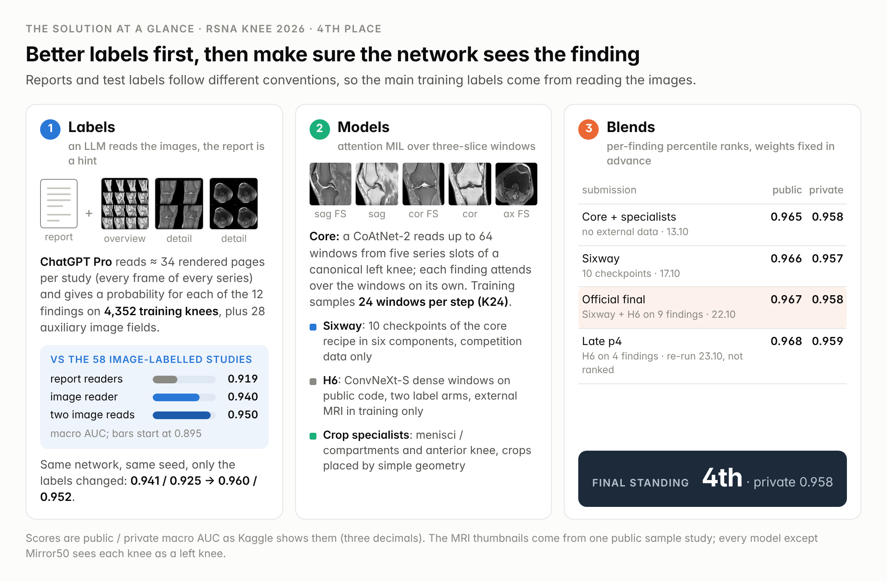
*Figure 1. Labels, models and blends in one picture; every number is explained in the sections below.*

## TL;DR

1. **Labels were the whole game.** Training studies came with free-text reports, the test was labelled by radiologists from the images. We had ChatGPT Pro *look at rendered MRI panels* of every training study (the report was shown first, as an untrusted hint) and trained on those "VM labels". Same network, same data, same seed, only the labels changed: **0.941 / 0.925 → 0.960 / 0.952** (public / private).
2. **An RSNA-only solution, built from scratch, reached 0.965 / 0.958.** One CoAtNet-2 attention-MIL "core" over up to 64 slice triplets, trained with 24 sampled windows per step (K24), plus two crop specialists that look at the menisci/compartments and at the anterior knee. The crops are placed by a few hundred lines of NumPy geometry (joint line from intensity profiles, intercondylar notch, skin line), with no segmentation network and no external data.
3. **The final week added +0.002 public and +0.000 private.** A 10-checkpoint ensemble of the core recipe ("Sixway") plus a ConvNeXt on public code trained with external knee MRI (H6) moved our official final to 0.967 / 0.958 (both selected submissions scored exactly that), the same private score as the RSNA-only hybrid.
4. **Our best blend (p4) failed to score because of a guard we wrote ourselves.** On deadline day Kaggle's hidden-test runs were unusually slow (p4 hit its time budget after 8 h 38 min). The notebook had a strict rule: if more than 3 % of the studies miss the time budget, write no `submission.csv`. That rule fired. The same notebook, with "unfinished study → fall back to the base ensemble" added, ran in 4.7 h the next day and scored **0.968 / 0.959**, the best of all our ~170 submissions on both splits.

| Step (date) | Public | Private |
|---|---:|---:|
| Public DINOv2 notebook reproduced (29.08) | 0.936 | 0.920 |
| CoAtNet-2 MIL core, report-derived labels (09.09) | 0.941 | 0.927 |
| Best ensemble on report labels: core + crop specialists + ResNet (20.09) | 0.952 | 0.936 |
| **Same core, VM image-reader labels**, one fold model (04.10) | 0.960 | 0.952 |
| Core K24, full fit (13.10) | 0.964 | 0.955 |
| **RSNA-only hybrid**: K24 core + compartment + anterior specialists (13.10) | **0.965** | **0.958** |
| Sixway: equal mean of 6 K24-family components, 10 checkpoints (17.10) | 0.966 | 0.957 |
| Official final: Sixway + H6 ConvNeXt, rank blend (22.10) | 0.967 | 0.958 |
| **Late p4**: Sixway + H6 on 4 columns only (re-run 23.10, not ranked) | **0.968** | **0.959** |

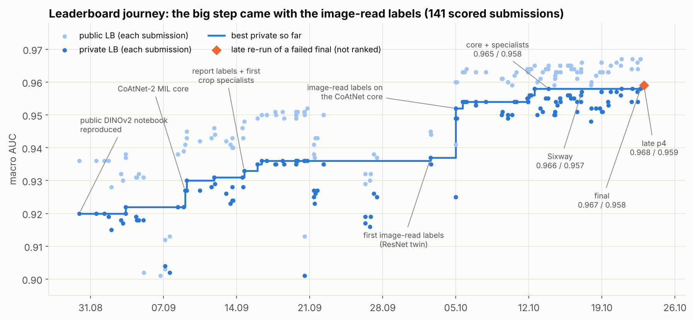
*Figure 2. Every scored submission (public light, private dark) and the best private score so far; the step at 04.10 is the switch to image-reader labels.*

---

## 1. The problem: train labels and test labels speak different languages

- **Train:** 4,407 studies (≈ 24k series, ≈ 800k frames), each with the clinical report (9 languages, median ≈ 1,000 characters). Image-based labels exist for only **58 training studies (we call them Gold58)**.
- **Test:** ≈ 1,300 studies, each labelled from the images by two MSK radiologists with a third adjudicating, using strict organiser definitions ("borderline = negative", "OA = > 50 % cartilage loss over ≈ 1 cm", "moderate or large effusion"). The host confirmed in the forum that the test labels come from the images, not from the reports, and that reports and image labels may disagree.

So every one of the ≈ 52k training cells had to be produced by us, and the target convention is the image convention. Reports follow a different one: they call "mild OA" and "small effusion" freely, often skip incidental findings, and a few are simply wrong (one knee study carries a shoulder report; several Dutch reports stop at "Bevindingen:"). How far apart the two conventions are, measured on the same ≈ 4,350 training studies (share of positive labels at p ≥ 0.5):

| Finding | Report readers (Core5new) | Image reader (VM) |
|---|---:|---:|
| Medial OA | 25.8 % | 16.0 % |
| Lateral OA | 15.2 % | 5.6 % |
| PF OA | 29.3 % | 16.1 % |
| MCL | 4.7 % | 2.4 % |
| Synovitis | 13.0 % | 20.1 % |
| ACL / menisci | 12.6 / 40.4 / 15.2 % | 11.2 / 37.1 / 13.5 % |

The ligaments and menisci agree; the graded findings do not. This is exactly where the image reader earned its keep.

## 2. VM labels: ChatGPT Pro as an image reader

### What the reader sees

For each study we render a fixed packet ("menu B", median 34 PNG pages, budget 42) from every series of the study:

- **overview pages:** every frame of every series, 4×4 tiles of 420 px, each tile captioned with its index and physical position (`i=007 z=64.7`);
- **detail pages:** one fluid-sensitive series per plane at native matrix (tiles 640–960 px, 2×2): all axial frames, 20 evenly spaced coronal and sagittal frames;
- **a second, wider window** on the axial FS series (for bright fluid and marrow oedema), and anatomic non-FS series when their matrix is much finer.

One window per series (0.5–99.7 percentiles), tiles scaled by PixelSpacing so proportions are true.

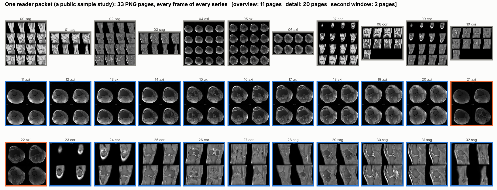
*Figure 3. All 33 pages the reader received for one public sample study: overview pages (grey), detail pages (blue), second window (orange).*

### How it reads

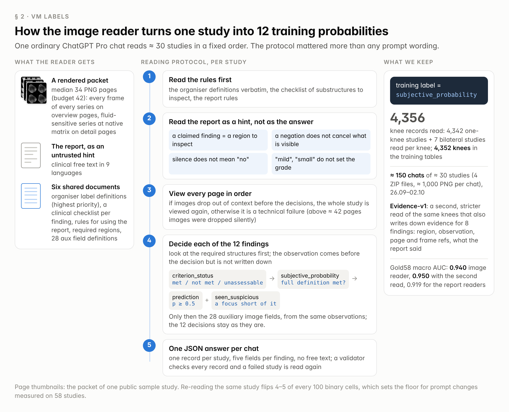
*Figure 4. The reading protocol, step by step. The training label is each finding's `subjective_probability`.*

The protocol is the part that matters more than any prompt wording:

1. Read the organiser's label definitions verbatim, a short clinical checklist per finding (which substructures must be inspected) and a rule sheet on how to use the report.
2. **Read the report first, as an untrusted hint.** A claimed finding is a reason to inspect that region; a negation does not cancel what is visible; silence does not mean "no"; words of degree ("mild", "small", "незначительный") do not set the grade.
3. View every page in order. In long contexts the model silently drops images (above ≈ 42 pages per study this became non-deterministic, hence the budget), so if images drop out before the decisions are fixed, the whole study is viewed once more; if that fails too, the study is returned as a technical failure.
4. For each of the 12 findings, inspect the required structures and make the observation first (it is not written down), then `criterion_status` (met / not met / technically unassessable) → `subjective_probability` that the *full* organiser definition is met → prediction = p ≥ 0.5, plus `seen_suspicious` for a specific focus that falls short of the definition. Only after the 12 decisions are fixed, 28 auxiliary image fields are filled from the same observations (cartilage grade per compartment, marrow oedema by zone, effusion size, meniscal extrusion, Hoffa oedema, loose bodies, ...); the decisions are not changed afterwards.
5. One compact JSON answer per chat with one record per study: five fields per finding, no rationale or free text. A validator checks every record; failed studies are read again.

The training label is `subjective_probability`. Production run: **4,356 knee records** (4,342 one-knee studies plus 7 bilateral studies read per knee) in ≈ 150 ordinary ChatGPT Pro chats of ≈ 30 studies each (4 ZIP files, ≈ 1,000 PNG per chat), 26.09–02.10; 4,352 of them form the training tables (4 studies are outside our image cache). A second read of the same knees with a stricter, evidence-first prompt ("Evidence-v1", usable for 4,350 of the 4,352) also writes down the evidence for eight findings: the region, a short observation, page and frame references, and how the report's claim relates to the images. The host's pinned forum post explicitly allowed commercially hosted LLMs for processing competition data.

We developed the protocol on Gold58 with several LLMs before running it at scale. Things that did *not* help: crops of the relevant region instead of the full packet; showing the reader a CNN's prediction (it follows the hint, and averaging afterwards is better); a smaller model (much worse); more pages (images get dropped). Re-reading the same study flips 4–5 of every 100 cells, which sets the floor for "prompt improvements" measured on 58 studies.

### How good the labels are

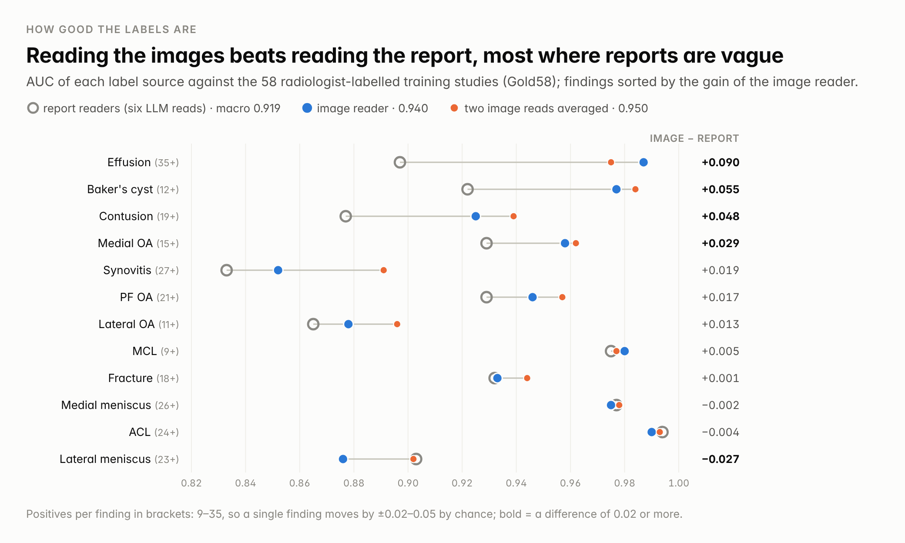
*Figure 5. AUC of three label sources against Gold58, sorted by the gain of the image reader over the report readers.*

Against Gold58 (9–35 positives per finding, so ±0.02–0.05 per column): report readers (Core6, the mean of six LLM readings of the report) 0.919 macro AUC, the image reader 0.940, two image reads averaged 0.950. The gains are where reports are vague or silent: effusion +0.090, Baker's cyst +0.055, contusion +0.048, medial OA +0.029. The image read is clearly worse only on the lateral meniscus (−0.027).

The decisive test is a twin experiment, one variable at a time:

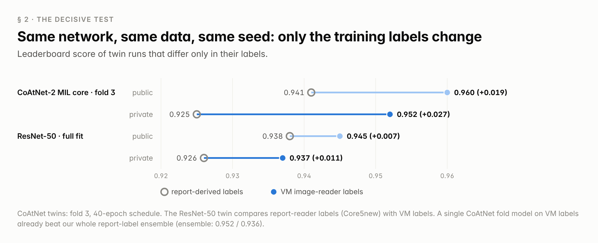
*Figure 6. Twin runs on the leaderboard: ring = report-derived labels, dot = VM labels.*

On the CoAtNet core, fold 3, 40-epoch schedule: report labels 0.941 / 0.925, VM labels 0.960 / 0.952 (**+0.019 public, +0.027 private**). A single fold model on VM labels beat our whole previous report-label ensemble (0.952 / 0.936). On a small ResNet-50 the same swap gave +0.007 / +0.011. Held out, Gold58 saw the difference (+0.017 for the CoAtNet twins); inside the training set (the ResNet twins) it could not see it at all (0.955 vs 0.956 in-sample).

### The student beats its teacher

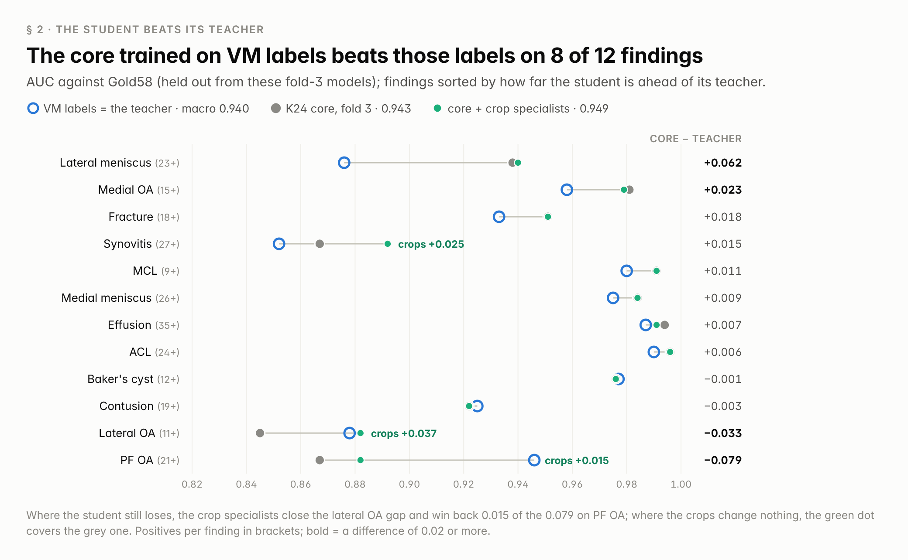
*Figure 7. The fold-3 core against the VM labels it was trained on, both scored on Gold58 (held out).*

The K24 core trained on VM labels scores 0.943 on Gold58 against 0.940 for the VM labels themselves, and wins on 8 of 12 findings: 4,000 noisy readings average out. Where the two disagree strongly, the student is usually right: **when the core is ≥ 0.4 above the VM label, Gold58 is positive in 88 % of the cells (22 of 25)**, and the zone is the same across fold models. That gave us a cheap, rule-based label repair (one of the ensemble members): in that zone, if an independent channel (the report readers or a text-trained CNN) also says "positive", replace the VM label by the core's calibrated out-of-fold prediction. It touches 1.7 % of the cells.

Where the student still loses to the teacher (PF OA 0.867 vs 0.946, lateral OA), the missed pairs are mostly ordered correctly by the report text and by neither of our image models. The teacher knew it from the report; the network has to find it in the pixels. That is the job of the crop specialists.

## 3. The core: CoAtNet-2 attention MIL with K24 bags

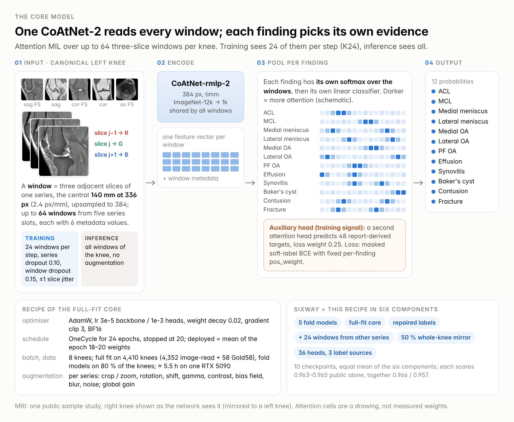
*Figure 8. The core model. Its recipe trains all ten Sixway checkpoints; the table in § 6 lists what each component changes.*

**Input.** Every knee is first turned into a canonical left knee (§ 5). From five series slots (sagittal FS, sagittal non-FS, coronal FS, coronal non-FS, axial FS) we take up to 64 windows; a window is three adjacent slices stacked as RGB, the central 140 mm of the field of view at 336 px (2.4 px/mm, upsampled to 384 for the backbone), plus 6 metadata values (relative position in the series, offset in mm, fat-suppression one-hot).

**Model.** `coatnet_rmlp_2_rw_384.sw_in12k_ft_in1k` from timm encodes each window; a per-finding attention head (each finding has its own softmax over windows, then its own linear classifier) gives 12 main outputs, and a second attention head gives 48 auxiliary outputs trained on report-derived targets (weight 0.25). Loss: masked soft-label BCE with fixed per-finding `pos_weight`.

**Recipe.** AdamW, lr 3e-5 backbone / 1e-3 heads, OneCycle scheduled for 24 epochs and stopped at 20, average of the epoch 18–20 weights, batch 8 knees, weight decay 0.02, gradient clip 3, BF16, seed 20260908, full fit on 4,410 knees (the 4,352 VM-labelled knees plus the 58 Gold58 studies with their binary labels; fold models train on 80 % of the VM knees). Augmentation "E1": per-series crop/zoom, rotation, shift, gamma, contrast, bias field, blur and noise, plus series dropout 0.10, window dropout 0.15, ±1 slice jitter and a global gain. Switching off the image part of E1 cost −0.003 / −0.004 on the leaderboard (one run). One RTX 5090, ≈ 5.5 h per full fit.

**K24, the one architectural change that mattered.** Training samples K of the ≤ 64 windows per study (inference always uses all of them). At K = 12 a finding that is visible in 2–3 windows is absent from the bag in 60–70 % of the steps, so the loss asks for "positive" on a bag with no evidence.

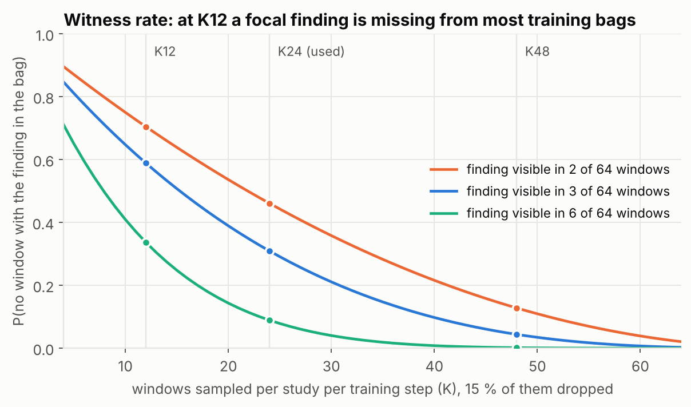
*Figure 9. Probability that a finding visible in 2, 3 or 6 of 64 windows is missing from a training bag of K windows.*

Going from K12 to K24 with everything else fixed: +0.003 held-out on two label proxies (bootstrap CI > 0), +0.005 on Gold58, fold 3 on the leaderboard 0.960 / 0.949 → 0.963 / 0.951 (both on the 20-epoch recipe). The gain went exactly to the focal findings (lateral OA +0.009, PF OA +0.007, ACL +0.006, synovitis +0.005, contusion +0.004 on the held-out proxy) and not to the diffuse ones (effusion, Baker's, medial meniscus ≈ 0). It is not just more compute: K12 trained for 30 epochs instead of 20 changed nothing. K48 was worse (0.959 / 0.950); our guess is that many studies have fewer than 48 distinct windows and the bag fills up with repeats.

Things that measured ≈ 0 on this core: a transformer or BiGRU context layer across windows, cross-plane feature fusion, other MIL poolings (log-mean-exp, top-k, gated), test-time augmentation (more in § 8).

## 4. Two crop specialists, placed by geometry

The core sees the whole knee at 2.4 px/mm. Cartilage loss over 1 cm, a meniscal tear touching the surface on two images, a thickened synovium in a recess: these live in a few millimetres. Both specialists use the same CoAtNet-2 MIL network on crops at 3.5–4.3 px/mm, are trained on the VM labels for their main findings plus region-specific auxiliary targets, and follow the core's recipe (full fit with Gold58, 24-epoch schedule stopped at 20, average of epochs 18–20).

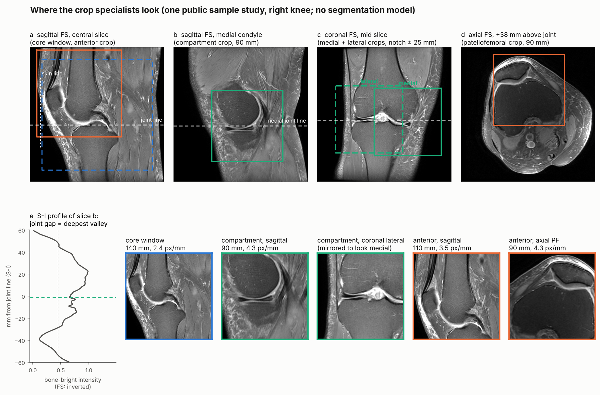
*Figure 10. The specialists' crops on one public sample study: joint line from an intensity profile (e), medial and lateral compartments, skin line and patellofemoral crop.*

### Compartment specialist (medial/lateral menisci and OA)

1. **Joint line from intensity profiles.** On candidate slices (sagittal slices through each condyle, coronal slices in the middle 40 % front to back) take the mean intensity of the central 40 % band along the superior–inferior axis, normalise it, smooth it over 6 mm and look for the deepest valley that has a bright plateau (≥ 0.45) within 45 mm on *both* sides: bone marrow above, bone marrow below, joint space in between (panel e). On fat-suppressed series the marrow is dark, so both polarities are tried and the data decide which one gives a coherent answer (median absolute deviation of the valley height across slices ≤ 6 mm, at least 3 slices).
2. **Two planes must agree.** The best sagittal and the best coronal option are paired by cost (height gap + spread + a penalty if the chosen polarity contradicts the fat-suppression tag). If they agree within 10 mm, the joint height is their mean; otherwise the sagittal one is used. Medial and lateral heights are taken separately from the sagittal slices of each condyle when they agree within 10 mm.
3. **Compartments.** The intercondylar notch is the midpoint of the sagittal stack; sagittal slices in the outer 42 % on each side belong to the medial or the lateral compartment (neighbours are clamped at the boundary, never borrowed from the notch). Coronal crops are centred 25 mm medial and lateral of the notch.
4. **Crops.** 90 mm squares at 384 px (4.3 px/mm), resampled in an orthonormal basis of the actual image plane so oblique acquisitions keep true scale, centred at the joint line. The lateral coronal crop is mirrored so both compartments look the same, and **one network learns "meniscal tear" and "compartment OA" for both compartments** (8,814 compartment rows from 4,407 knees; 48 windows per compartment, 12 sampled per step; 2 main + 12 auxiliary heads).

### Anterior specialist (PF OA, effusion, synovitis)

1. **Skin line.** On central sagittal slices, rows 10–45 mm above the joint line, scan from the front for the first run of ≥ 3 mm above 10 % of the intensity range that stays ≥ 60 % filled over the next 10 mm. The median over ≥ 3 slices is the anterior skin position. If the spread across slices exceeds 6 mm, the skin position is fitted as a smooth curve across slices and must be confirmed by the other sagittal series before it is accepted.
2. **Crops in patient millimetres** (384 px each): sagittal from 5 mm in front of the skin to 105 mm behind it and from 15 mm below to 95 mm above the joint line (patella, quadriceps and patellar tendons, suprapatellar recess, Hoffa's fat pad); axial patellofemoral crops 90 × 90 mm around the notch from the skin backwards, on axial slices 10–65 mm above the joint line.
3. 48 windows (14 + 14 sagittal FS/non-FS, 10 + 10 axial FS/non-FS), 11 metadata values, 3 main + 13 auxiliary heads (patellar and trochlear cartilage grade, patellar marrow oedema, effusion size, bursitis, plica, Hoffa oedema, tendons, patellar tilt, trochlear dysplasia, loose bodies).

If a localiser cannot find a coherent joint line or skin line, the study keeps the core's prediction for those findings (in training the compartment crops failed on 3 of 4,352 knees, the anterior ones on none).

### Routing

Per finding, percentile ranks over the whole test set, 50 / 50 core and specialist, weights fixed before submission: menisci and medial/lateral OA with the compartment model, PF OA / effusion / synovitis with the anterior model, the other five findings from the core alone.

| | Public | Private | Gold58 (fold 3) |
|---|---:|---:|---:|
| K24 core alone | 0.964 | 0.955 | 0.943 |
| + compartment + anterior specialists (RSNA-only hybrid) | 0.965 | **0.958** | 0.949 |

On Gold58 the specialists add +0.037 to lateral OA, +0.015 to PF OA and +0.025 to synovitis. On the leaderboard the hybrid moved the private score three times more than the public one; we only learned that after the deadline.

## 5. Side and orientation (v8.3)

Every input is converted to a canonical left knee: axial and coronal frames mirrored, sagittal triplets reversed, so one network serves both knees and the specialists can rely on "medial" meaning the same thing everywhere. The side comes from three sources: the laterality tag, DICOM geometry (the knee sits off the table centre) and a ResNet-50 that looks at 7 frames per series (on axial and coronal frames it finds the fibula, on sagittal series it reads how the anatomy changes along the slice order; extra heads check pose and slice order). Votes are combined as `2·axial + coronal + sagittal` + 0.5 for the tag + 0.25 for geometry, and a decision needs at least two agreeing planes. Tag and geometry already settle about 94 % of the studies; the image votes matter for knees near the table centre without a tag.

Compared with our first tag-and-geometry rule, v8.3 changed the side of 118 studies (2.7 %: 99 without any side information, 18 flips, 1 prone patient), agrees with geometry wherever geometry is decisive (4,070 / 4,070 on train), and was 334 / 334 correct on studies whose tags we hid. In AUC terms it is tiny (≈ +0.0001 out-of-fold), but the policy has to match between training and inference: a model trained on v8.3-canonical inputs lost 0.002 on the leaderboard when run with the old rule.

## 6. The final week: Sixway, H6 and the submission that did not score

**Sixway** is the equal mean of six K24-family components, 10 checkpoints, RSNA data only. Each scores 0.963–0.965 public alone; together 0.966 / 0.957. No specialists: our attempts to add them on top were never measured (see the lesson below).

| Component | What differs from the full-fit core (§ 3) | Checkpoints |
|---|---|---:|
| K24 folds | five fold models on 80 % of the knees each, averaged as one member | 5 |
| Full-fit core | nothing: the recipe of § 3 | 1 |
| VM-repair | trained on the repaired VM labels (§ 2) | 1 |
| Adaptive | up to 24 extra windows from the series the five slots leave out (axial non-FS, a second sagittal FS, oblique coronals) | 1 |
| Mirror50 | 50 % whole-knee mirroring, so it runs on raw orientation without a side decision | 1 |
| Joint36 | 36 heads on three label sources (VM, Evidence-v1, report readers), read out as an equal rank mean of its heads | 1 |

**H6** is a ConvNeXt-S on the public R7 training code of [heliosli]: dense 3-slice windows, joint crops anchored by an SKM-TEA-trained V-Net, fastMRI+ boxes as an auxiliary loss (full recipe: `training/H6_RECIPE.md`). It is trained on our labels in two separate arms:

- **Core6 arm:** report-reader labels; on OAI knees, MOAKS grades as targets for Lateral OA, PF OA and synovitis only (the other nine findings masked, as in [nartaa]'s public CoAtNet solution).
- **VM arm:** VM labels, with a separate head for the OAI knees.

In the official final it is the only model with external MRI (OAI, fastMRI); the RSNA-only hybrid and Sixway use none. Rank-blended into Sixway it added +0.001 / +0.001 (official final, 9 columns) and +0.002 / +0.002 (p4, 4 columns). (Our other selected final, Sixway plus two CoAtNet variants whose training also included OAI knees with VM labels, scored 0.967 / 0.958 as well.)

| | Columns where H6 enters (rank weights) | Public | Private |
|---|---|---:|---:|
| Official final 57532611 | OA ×3 + Baker's (Sixway .5 / H6 .25 + .25), ACL/MCL/menisci (.75 / .25), contusion (.5 / .25 + .25) | 0.967 | 0.958 |
| **p4** 57519900 → re-run 57543464 | only OA ×3 + Baker's (.5 / .25 + .25); other 8 columns pure Sixway | **0.968** | **0.959** |

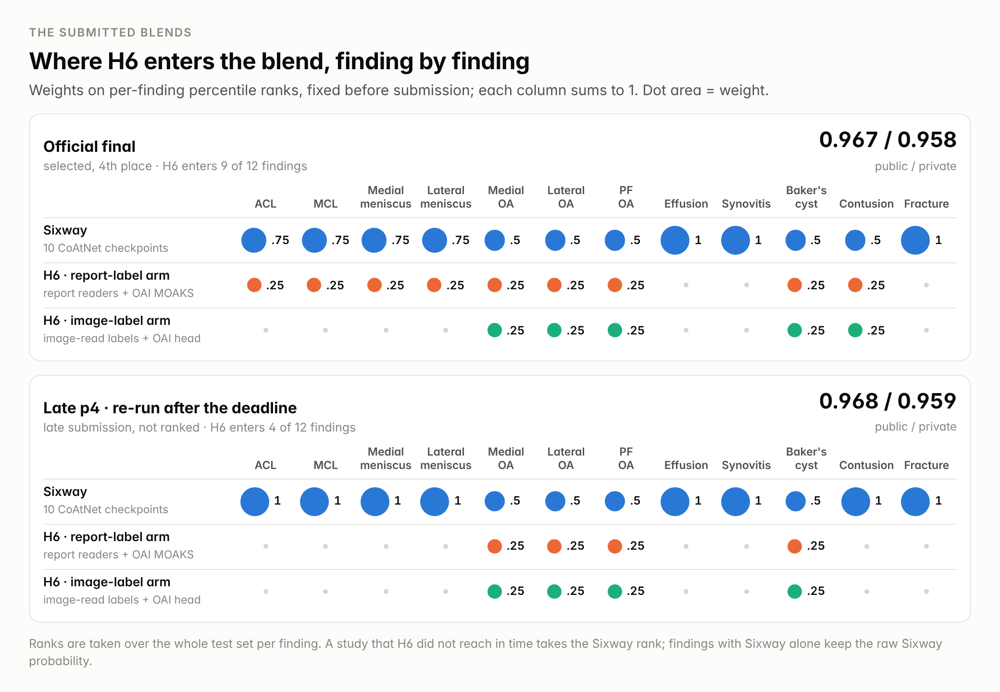
*Figure 11. Rank weights of the three members, finding by finding, in the official final and in late p4.*

**Why p4 did not score.** p4 was submitted on 22.10 at 09:59 UTC. Our notebooks checked themselves hard: if more than 3 % of the studies failed in H6, the notebook wrote no `submission.csv` rather than a silently degraded one. H6 runs after Sixway with a fixed time budget. On deadline day Kaggle's hidden-test runs were much slower than in the days before (Sixway-type kernels took 2.3–2.6 h on 18–20.10 and 3.5–6.6 h on 22.10), H6 ran out of budget on more than 3 % of the studies, and p4 finished after 8 h 38 min without a score. The two blends we built later that day (one of them is our official final) already carried the rule "a study H6 did not reach in time gets the Sixway rank" and scored. The day after the deadline we re-ran p4 unchanged (same weights, same cells, plus that fallback): 4.7 h, **0.968 / 0.959**. With 0.959 we would have been third or fourth, depending on unrounded scores.

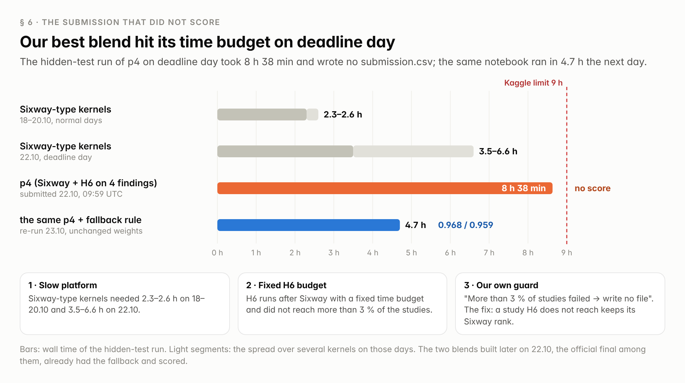
*Figure 12. Wall time of the hidden-test runs: on 22.10 the platform was slower, H6 hit its time budget and our strict guard wrote no file.*

## 7. Per-finding AUC from column probes

After the competition we sent 25 late submissions that keep one column and set the other 11 to 0.5: score = (AUC + 11 · 0.5) / 12, so AUC = 12 · score − 5.5. The numbers below are calibrated so that the twelve findings of each submission average to its leaderboard score (details under the table); each one is good to about ±0.006.

What the probes say:

- **The RSNA-only hybrid and p4 differ on two findings out of twelve.** On private, p4 is ≈ 0.011 higher on Lateral OA (0.951 → 0.962; Sixway plus H6 instead of the core plus the compartment specialist) and on fracture (0.939 → 0.950; Sixway instead of the single core) and within 0.001 elsewhere. Those two findings are the whole gap between the full submissions (0.958 vs 0.959).
- **The weak findings are the same for both:** synovitis (0.89), contusion (0.93), PF OA (0.94), fracture (0.94–0.95). ACL, the medial meniscus, effusion and Baker's cyst are at ≈ 0.99.
- **Public and private rank the findings differently.** Synovitis is 0.95 on public and 0.89 on private; Lateral OA is the other way round (0.92–0.93 public, 0.95–0.96 private). On ≈ 390 public studies a finding with a few dozen positives moves by one or two display steps (0.012 each), and per-finding weights tuned on public probes inherit that noise.

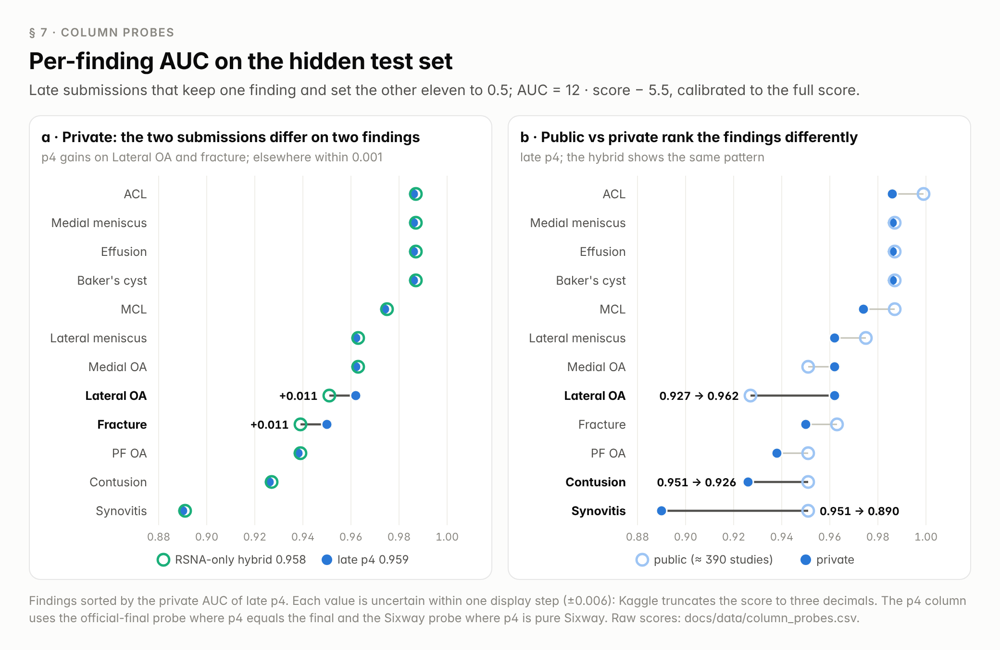
*Figure 13. Calibrated per-finding AUC: (a) the RSNA-only hybrid against late p4 on private, (b) public against private for late p4.*

| Finding | Hybrid public | Hybrid private | p4 public | p4 private |
|---|---:|---:|---:|---:|
| ACL | 0.996 | 0.987 | 0.999 | 0.986 |
| MCL | 0.984 | 0.975 | 0.987 | 0.974 |
| Medial meniscus | 0.984 | 0.987 | 0.987 | 0.986 |
| Lateral meniscus | 0.972 | 0.963 | 0.975 | 0.962 |
| Medial OA | 0.948 | 0.963 | 0.951 | 0.962 |
| Lateral OA | 0.924 | 0.951 | 0.927 | 0.962 |
| PF OA | 0.948 | 0.939 | 0.951 | 0.938 |
| Effusion | 0.984 | 0.987 | 0.987 | 0.986 |
| Synovitis | 0.948 | 0.891 | 0.951 | 0.890 |
| Baker's | 0.984 | 0.987 | 0.987 | 0.986 |
| Contusion | 0.948 | 0.927 | 0.951 | 0.926 |
| Fracture | 0.960 | 0.939 | 0.963 | 0.950 |
| *mean of the 12 = full submission* | *0.965* | *0.958* | *0.968* | *0.959* |
| *constant added to the raw probes* | *+0.004* | *+0.007* | *+0.007* | *+0.006* |

The hybrid column is our RSNA-only submission 57156616; the p4 column takes the official-final probe where p4 and the final are identical (OA ×3, Baker's, effusion, synovitis, fracture) and the Sixway probe where p4 is pure Sixway (ACL, MCL, menisci, contusion). Kaggle shows scores truncated to three decimals, so a raw probe (AUC = 12 · score − 5.5) underestimates its finding by 0 to 0.012, and the twelve raw probes averaged 0.004–0.007 below the macro AUC of their full submission. The table adds one constant per column so that the twelve values average exactly to the submission's score. A single cell stays uncertain within one display step, a window 0.012 wide. Raw scores are in `docs/data/column_probes.csv`. One extra probe covers a column where only the official final uses H6: ACL with H6 at 0.25 scores the same as pure Sixway.

## 8. What did not work (leaderboard, public / private)

| Idea | Result | Reference |
|---|---|---|
| Report-label twin averaged with the VM-label twin (ResNet-50) | 0.944 / 0.935 | 0.945 / 0.937 |
| Self-distillation: mixing the model's out-of-fold predictions into the labels | −0.002 public | report-label core |
| Gold58 with weight 5 in training | 0.940 / 0.924 | 0.943 / 0.928 |
| Vendor histogram transfer on top of E1 | 0.937 / 0.925 | 0.938 / 0.926 |
| K48 instead of K24 (fold 3) | 0.959 / 0.950 | 0.963 / 0.951 |
| 384 px windows instead of 336 (K24 full fit) | 0.963 / 0.953 | 0.964 / 0.955 |
| EfficientNetV2-S / ConvNeXt-T as a 25 % rank member (fold 3) | 0.962 / 0.950, 0.961 / 0.951 | 0.963 / 0.951 |
| Cross-label ridge post-processing on out-of-fold predictions | 0.963 / 0.954 | 0.964 / 0.955 |
| Bounded BCE (cap on how far a logit can be pushed by noisy labels) | 0.963 / 0.951 | 0.963 / 0.951 |
| Zoomed test-time windows (0.92× / 0.96× field of view) | 0.963 / 0.954 | 0.963 / 0.954 |
| Public notebook pair as a 30 % rank member | 0.965 / 0.955 | 0.964 / 0.955 |

## 9. Lessons

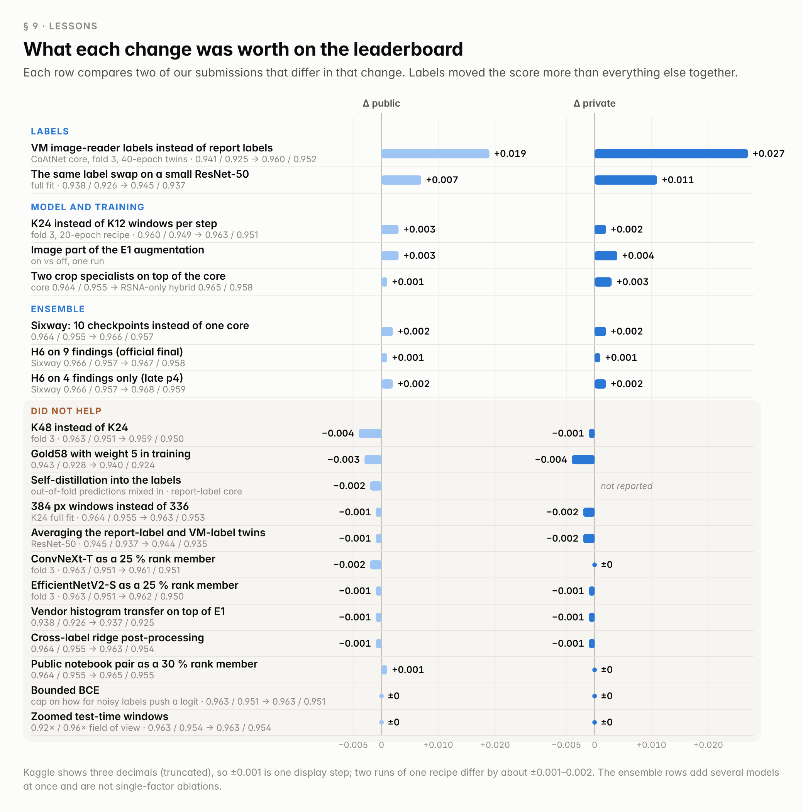
*Figure 14. Leaderboard change of every change we measured, one pair of submissions per row.*

- **Spend on labels first.** One week of an LLM reading images beat everything we had built on report labels: one fold model on VM labels scored +0.016 private over our full report-label ensemble. The reader's protocol (report as a hint, the full organiser definition, an explicit status before the probability, every frame visible) mattered more than any prompt tweak.
- **A student trained on thousands of noisy labels can be a better labeller than its teacher**, and its disagreements tell you where the labels are wrong. The repaired labels were a cheap extra ensemble member.
- **Find the evidence before you scale the model.** K24 and the crop specialists are both "make sure the network actually sees the finding" changes; deeper context layers, poolings and backbones were all ≈ 0.
- **Hand-written anatomy is enough for crops.** Intensity profiles, DICOM geometry and two-plane agreement placed the compartment crops on all but 3 of 4,352 training knees, with no segmentation network.
- **A small gold set is a weak judge.** In-sample it is blind; held out it has 9–35 positives per column, and label changes it liked (two reads averaged: +0.010 on Gold58) did not transfer (0.962 vs 0.963 public). The public LB (≈ 390 studies) moves in steps of 0.001 ≈ one positive with ±0.003 noise, and the private score rewarded the specialists more than the public one suggested. We fixed weights before submitting and read each change against a rule declared in advance.
- **In a code competition, never let a guard write nothing.** Prefer a degraded but valid file with a logged reason. Two related traps cost us submissions: (1) the strict "> 3 % failed → no file" rule that killed p4; (2) an early cell that wrote `submission.csv` before its own checks: when a check failed on the hidden set, the later "blend" cells never ran and Kaggle scored the early file. Four "Sixway + X" submissions silently scored as plain Sixway before a probe exposed it. Run every stage as a separate process, rename its output, and make the last cell the only one that writes `submission.csv`.

## 10. Reproducibility

This repository reproduces the **official final (57532611)** end to end: `predict.py` gives a byte-identical `submission.csv` on the public test sample (checked in a private Kaggle notebook), its unmasked late submission on the hidden test scored 0.967 / 0.958 like the final, and `predict.py --blend late_p4` gives the p4 blend from the same models. `train.py --model <name>` retrains every checkpoint from the frozen historical training sources (each file verified by SHA-256), and a CPU smoke test checks every training entry point. See `README.md` and `docs/REPRODUCIBILITY.md`. The RSNA-only hybrid (57156616) is a separate Kaggle notebook with its own weights; it is not part of this repository.

Hardware: training on rented single RTX 5090 instances (≈ 5–7 h per CoAtNet full fit); inference on Kaggle 2×T4 (K24 core ≈ 0.5 h, RSNA-only hybrid ≈ 3 h, final ≈ 4.5–5 h on a normal day).

## Acknowledgements

RSNA, the annotating radiologists and Kaggle for the competition and the careful label definitions. Public label tables by laymond and yunus (two of our six report readers). The public R7 ConvNeXt code and SKM-TEA anchors by heliosli, on which H6 is built; nartaa for the public example of OAI supervision on Lateral OA, PF OA and synovitis. timm (CoAtNet weights) and Meta (ConvNeXt weights). OAI and fastMRI for the external MRI used by H6.

[heliosli]: https://www.kaggle.com/heliosli
[nartaa]: https://www.kaggle.com/nartaa
